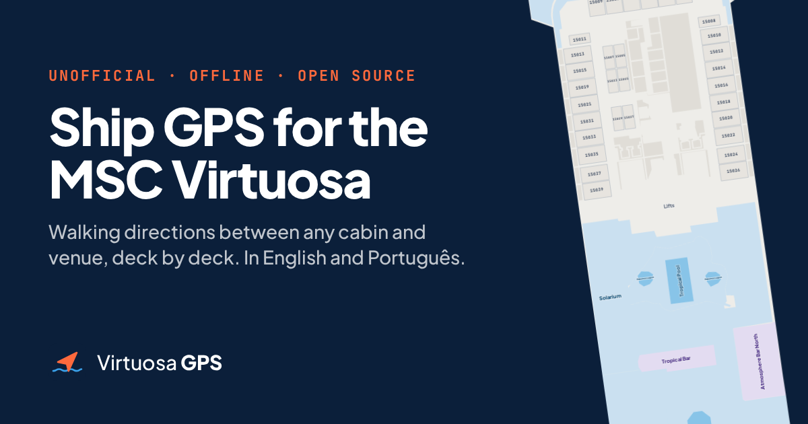

# Virtuosa GPS

**Walking directions inside the MSC Virtuosa cruise ship.** Pick where you are (a cabin or a venue) and where you want to go: the GPS shows the walking route, which lifts or stairs to take, and the plan of every deck along the way. It runs entirely in the browser and keeps working offline once loaded, which matters on a ship where internet is expensive or missing.

**Open it:** https://virtuosa-gps.vinicius741.workers.dev (English) · https://virtuosa-gps.vinicius741.workers.dev/pt/ (Português)

[Leia em português](README.pt-BR.md)

> Unofficial project made by passengers. It is not affiliated with, endorsed by or connected to MSC Cruises. "MSC" and "MSC Virtuosa" are trademarks of their owners and are used here only to say which ship the plans describe. Plans and routes are approximate: always follow the signs on board and the crew's instructions.



## What's inside

| Path | What it is |
|---|---|
| `public/plantas/deck-N.svg` | Redrawn plan of each of the 14 guest decks (5–16, 18, 19), with every venue, cabin, lift, stairway and door. Clickable: rooms carry `data-lugar`, `data-n` (name) and `data-t` (description). |
| `public/plantas/rotas.json` | Route data: a walkable grid per deck, the three lift/stair banks, the entrance cell of every cabin and venue. |
| `src/gps/` | The GPS itself: an Astro component (`Gps.astro`), the routing engine (`lib/rotas.ts`, Dijkstra on the grid plus a deck-change graph), the ship side view, styles and the EN/PT-BR texts. |
| `src/site/`, `src/pages/` | This website: `/` in English and `/pt/` in Brazilian Portuguese. |
| `plantas/` | The pipeline that produced the plans and the route data (Python, see [plantas/README.md](plantas/README.md)). |

Features: search by cabin number or venue name, route split into walking steps with a zoomable plan for each, side view of the ship with the deck changes, named favorites ("Mom", "Grandma") stored on the phone and shareable by link (`?fav=Mom~c10123`), deep links to a route (`?de=c10021&para=p15-r169`), offline support through a service worker.

## Run it locally

Requires Node 22.23+.

```sh
npm install
npm run dev      # http://localhost:4321
npm run check    # types + checks that every plan text has an English translation
npm run build    # static site in dist/ (plus dist/sw.js for offline use)
```

The site is fully static. It is deployed as a Cloudflare Worker with static assets only (`wrangler.jsonc`, no server code): `npm run deploy`.

## Use it in your own site

The package is not on npm; install it from GitHub, pinned to a tag:

```sh
npm install github:vinicius741/virtuosa-gps#v0.1.0
```

```js
// astro.config.mjs: serves rotas.json and the deck SVGs at /plantas/ (dev and build)
import virtuosaGps from 'virtuosa-gps/integration';
export default defineConfig({ integrations: [virtuosaGps()] });
```

```astro
---
import Gps from 'virtuosa-gps/Gps.astro';
import 'virtuosa-gps/styles.css';
---
<Gps lang="pt" />  <!-- or "en" (default) -->
```

The component expects a few basic classes and design tokens from the page (`.card`, `.btn`, `.input`, `.lbl`, `.busca`, `--primary`, `--accent`, `--surface`…). Copy them from [`src/site/styles/site.css`](src/site/styles/site.css) and change the colors as you like. Other exports: `virtuosa-gps/rotas` (routing engine), `virtuosa-gps/zoom`, `virtuosa-gps/icons`, `virtuosa-gps/strings`, `virtuosa-gps/ShipProfile.astro`.

## Translations

The plans were written in Portuguese. English names and descriptions live in [`src/gps/i18n/places.en.json`](src/gps/i18n/places.en.json) (Portuguese text → English text) and are applied in the browser, so the plans and route data are the same for both languages. The interface texts are in [`src/gps/i18n/strings.ts`](src/gps/i18n/strings.ts). `npm run check` fails if a plan text has no translation.

## How the plans were made

The plans were redrawn from public reference images of the real deck plans. Those images are **not** included in this repository because they are not ours to license. A set of Python tools traced walls, rooms and cabins automatically, and AI agents then improved the drafts by hill climbing against a scorer: naming venues, fixing cabins, placing doors. The prompts and reports from those rounds are kept in `plantas/` (in Portuguese). The routing data is generated from the finished plans.

The code comments and identifiers are mostly in Portuguese, because the project started as a website for a Brazilian group trip.

## Contributing

Wrong door, missing venue, a route that walks through a wall? Open an issue with the two points (`?de=…&para=…` link) and a screenshot, or send a pull request. Plan fixes go in `plantas/specs/deck-N.json` through the `./pl` tools, then `./pl export` regenerates the SVGs and `rotas.json`.

## License

[MIT](LICENSE): the code, the redrawn plans and the route data.
