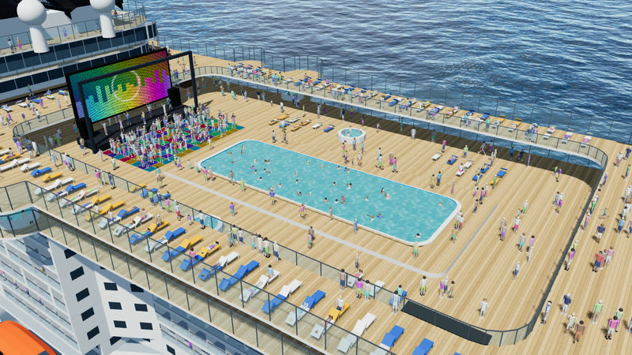
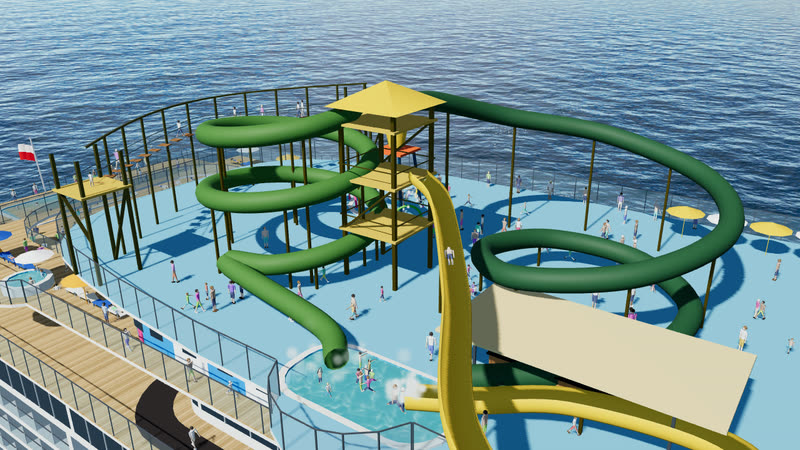
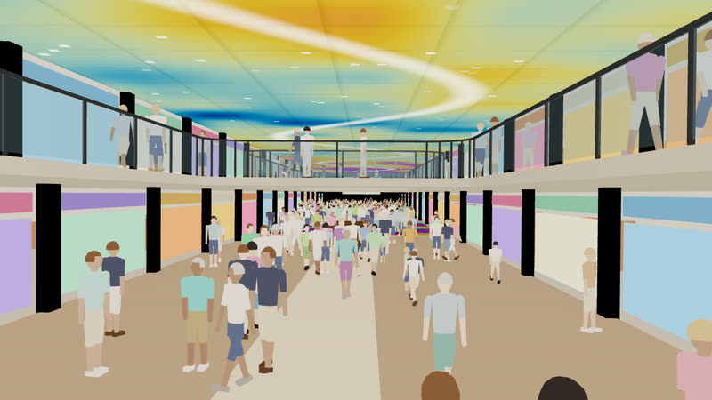
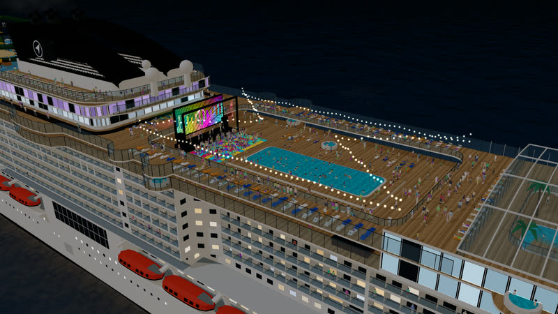
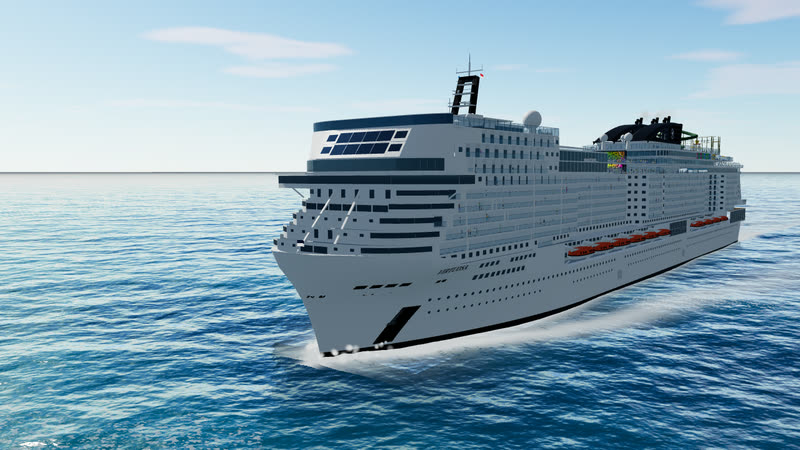
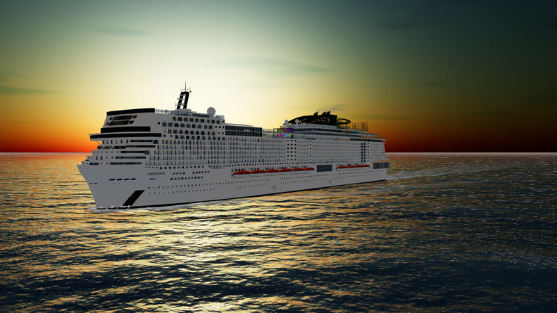

# Virtuosa GPS

**O caminho a pé dentro do navio MSC Virtuosa, e o navio inteiro em 3D.**

[](https://virtuosa-3d.vinicius741.workers.dev/pt/)

*O navio em 3D, rodando no navegador: [abra](https://virtuosa-3d.vinicius741.workers.dev/pt/) e passeie em volta dele.*

**O GPS.** Escolha onde você está (uma cabine ou um lugar) e para onde quer ir: o GPS mostra a rota a pé, qual elevador ou escada pegar e a planta de cada deck no caminho. Tudo roda no navegador e continua funcionando sem internet depois da primeira visita, o que faz diferença num navio onde a internet é cara ou não existe.

**Abrir:** https://virtuosa-gps.vinicius741.workers.dev/pt/ (Português) · https://virtuosa-gps.vinicius741.workers.dev (English)

[Read in English](README.md)

> Projeto não oficial, feito por passageiros. Não tem ligação com a MSC Cruzeiros nem aprovação dela. "MSC" e "MSC Virtuosa" são marcas dos seus donos e aparecem aqui só para dizer de que navio são as plantas. Plantas e rotas são aproximadas: siga sempre as placas do navio e as orientações da tripulação.

## O navio em 3D

As mesmas plantas também montam um modelo 3D do navio navegando, feito todo em código com three.js: nenhum modelo baixado, nenhuma textura de foto. O casco de 331 m, umas 1.300 varandas, a área da piscina, o parque aquático com os tobogãs, a Galleria por dentro e umas 2.400 pessoas que nadam, dançam, correm, descem os tobogãs e saem nas varandas. Arraste o relógio do meio-dia ao pôr do sol e à noite, e as luzes acendem.

**Abrir:** https://virtuosa-3d.vinicius741.workers.dev/pt/ (Português) · https://virtuosa-3d.vinicius741.workers.dev (English). A qualidade se ajusta ao aparelho, então roda no celular também.

| | | |
|---|---|---|
|  |  |  |
| Piscina | Parque aquático | Galleria, por dentro |
|  |  |  |
| Festa da piscina à noite | Proa | Pôr do sol |

Como foi feito e como usar no seu site: [ship3d/README.md](ship3d/README.md) (em inglês).

## O que tem aqui

| Caminho | O que é |
|---|---|
| `public/plantas/deck-N.svg` | Planta redesenhada de cada um dos 14 decks dos hóspedes (5 a 16, 18 e 19), com lugares, cabines, elevadores, escadas e portas. |
| `public/plantas/rotas.json` | Dados das rotas: a grade por onde dá para andar em cada deck, os três conjuntos de elevadores e escadas e a entrada de cada cabine e lugar. |
| `src/gps/` | O GPS: o componente Astro (`Gps.astro`), o cálculo da rota (`lib/rotas.ts`), a vista lateral do navio, os estilos e os textos em inglês e português. |
| `src/site/`, `src/pages/` | Este site: `/` em inglês e `/pt/` em português. |
| `plantas/` | As ferramentas que fizeram as plantas e os dados das rotas (Python, veja [plantas/README.md](plantas/README.md)). |

## Rodar no computador

Precisa do Node 22.23 ou mais novo.

```sh
npm install
npm run dev      # http://localhost:4321
npm run check    # tipos + confere se todo texto das plantas tem tradução para o inglês
npm run build    # site estático em dist/
```

## Usar no seu site

Instale pelo GitHub, numa versão fixa (`npm install github:vinicius741/virtuosa-gps#v0.1.0`), ligue a integração (`virtuosa-gps/integration`) no `astro.config.mjs` e use `<Gps lang="pt" />` com `import 'virtuosa-gps/styles.css'`. Detalhes no [README em inglês](README.md#use-it-in-your-own-site).

## Traduções

As plantas foram escritas em português. Os nomes e textos em inglês ficam em `src/gps/i18n/places.en.json` e os textos da interface em `src/gps/i18n/strings.ts`. Ao mudar o texto de um lugar nas plantas, acrescente a tradução: o `npm run check` avisa o que falta.

## Licença

[MIT](LICENSE): o código, as plantas redesenhadas e os dados das rotas.
